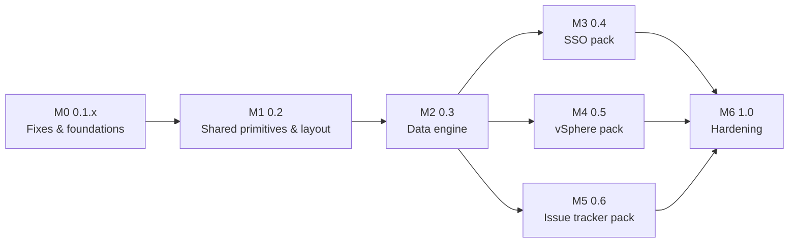

# pilab-laf — Roadmap to 1.0

Companion to [`design.md`](design.md) (IDs like **B1**, **U2**, **4.72** refer to it). Normative rules: [`COMPONENTS.md`](../COMPONENTS.md).

Sizes are rough effort for one developer: **S** ≤ 2 days, **M** ≈ 1 week, **L** ≈ 2 weeks. Milestones are sequential up to M2. After that, M3, M4 and M5 only depend on M2 and can run in parallel or be reordered.

## What each milestone unlocks

| Milestone | SSO | Issue tracker | vSphere |
|---|---|---|---|
| M0 | i18n (hu/en) via `LafProvider`, OIDC components deprecated | — | — |
| M1 | admin shell, settings pages, error pages | app shell, forms | app shell, create-VM wizard skeleton |
| M2 | user/client/audit lists at scale, realm tree | issue list, filtering, saved views | inventory tree + VM grids at scale |
| M3 | **full account self-service + admin** | — | (permission dialog reused) |
| M4 | — | (charts for burndown) | **inventory, object pages, console, perf** |
| M5 | (Markdown for help texts) | **issue page, board, comments** | — |
| M6 | 1.0 quality bar for all three | | |

---

## M0 — 0.1.x · Fixes & foundations
**Goal:** stop shipping known defects; lay the shared plumbing every later milestone needs.

| Item | Size |
|---|---|
| Initial commit, tag `v0.1.0`, `CHANGELOG.md`, semver policy (§4.H) | S |
| B1 deprecate `OidcClientList` / `OidcClientForm` (`@deprecated` JSDoc pointing to `shadow-sso-accounts`; removed in M1) | S |
| B2 FileDropzone accept + byte formatting | S |
| B3 DiffView LCS/Myers diff + unified mode | M |
| B4 Combobox portal (interim: Radix Popover around current list; full v2 in M1) | S |
| B5 KeyValueEditor stable keys · B6 SecretDisplay controlled + masked · B8 controllable TreeView/Accordion | S |
| F1 `LafProvider` + typed `LafMessages` (en built in, `hu` as `@pilab/laf/locales/hu`) · B7 string sweep | M |
| F2 `useControllableState` · F3 formatters | S |
| ADR-1 tree-shaking: ESM per-module output, `exports` for `./charts`, `./editor`, `./dnd`, `./locales/*` (empty entries), optional peer deps, `tests/treeshake.test.ts` with per-import budgets (design.md §2.2) | M |

**Exit criteria:** every B-item has a regression test (B1: deprecation notice only); `bun run test`, `typecheck`, `build` green in CI; tree-shake test passes (a `Button`-only bundle has no Dialog/Dropdown/Toast code and stays within budget); no string literals in components outside catalogues (rules test); `hu` playground renders without layout change.

---

## M1 — 0.2 · Shared primitives & layout
**Goal:** everything a first screen needs in any of the three apps.

| Item | Size |
|---|---|
| 4.62 Select · 4.63 SegmentedControl · 4.65 IconButton · 4.66 StatusDot · 4.67 RelativeTime | M |
| U3 Combobox v2 (cmdk) + wrappers (UserSelector, DeviceSelector, TenantSwitcher) | M |
| U4 Menu model: submenus, checkbox/radio items, shortcuts, `Menu`, `ContextMenuFor` | M |
| 4.64 ButtonGroup / SplitButton · 4.68 AvatarGroup | S |
| 4.72 Wizard (+ `WizardReview`) | M |
| 4.73 FormSection / FormFooter + unsaved-changes guard | S |
| 4.74 Page templates: TopBar, DetailPage, FormPage, SubNav, MobileNav | M |
| 4.75 ErrorPage / ErrorBoundary | S |
| Remove deprecated `OidcClientList` / `OidcClientForm` (B1) | S |
| F5 ObjectIcon registry (base icon set) | S |
| U9 PasswordField strength + confirm · U10 Accordion on Radix | S |

**Exit criteria:** playground has an "App shell" page using TopBar + SubNav + DetailPage + FormPage + Wizard, keyboard-only walkthrough recorded in tests; axe clean; the SSO admin can drop its local primitives.

---

## M2 — 0.3 · Data engine
**Goal:** lists and trees that scale; the backbone of all three products.

| Item | Size |
|---|---|
| U1 DataGrid v2 (TanStack Table + Virtual): multi-sort, selection ranges, resize, reorder, visibility, sticky, density, row actions, expandable rows, bulk bar, manual mode, `viewKey` | L |
| U2 TreeView v2: lazy children, multi-select, type-ahead, virtualization, context menu, disabled/status | L |
| TreeTable on the DataGrid engine (§4.30) · VirtualList on TanStack Virtual | S |
| 4.98 FilterBar + SavedViews (grammar published in design.md) | M |
| 4.77 InfiniteList / LoadMore | S |
| 4.76 ActionBar (overflow-measured, shares `MenuItemSpec`) | S |
| Playground benchmarks `?bench=grid` (50 000 rows), `?bench=tree` (10 000 nodes) | S |

**Exit criteria:** benchmarks scroll smoothly and keyboard navigation stays under 16 ms per step; server-side (`manual`) mode demo with fake latency; deprecation warnings for single `sort` / string `selected`.

---

## M3 — 0.4 · SSO pack
**Goal:** Shadow SSO account self-service and admin built purely from the kit.

| Item | Size |
|---|---|
| 4.82 SessionList | S |
| 4.84 ApiKeyManager (generic show-once secrets) | M |
| 4.85 SecurityFactors · U11 MfaEnrolment upgrades | M |
| 4.86 ReauthDialog / SessionExpiryDialog · U10 UserMenu impersonation/expiry | S |
| U11 PermissionMatrix (inherited, diff, search, grid keys) · 4.81 TransferList | M |
| 4.79 Network inputs (IP/CIDR for allow-lists) | S |
| 4.80 ColorField · 4.89 BrandingEditor | M |
| 4.70 NotificationCenter | S |
| Remove `OidcClientList` / `OidcClientForm` if M1 didn't | S |

**Exit criteria:** playground pages "Account › Security", "Account › Sessions", "Account › API keys", "Admin › Users & groups", "Admin › Roles", "Admin › Branding" compose only kit components; `shadow-sso-accounts` can build its OIDC screens (clients, IdPs, keys) from generic parts without app-local primitives; `bun run sync` still produces auth-page CSS unchanged (R9). OIDC/FedCM itself stays in `@pilab/shadow-sso` (design.md §1.3).

---

## M4 — 0.5 · vSphere pack
**Goal:** inventory navigation, object pages, operations and monitoring.

| Item | Size |
|---|---|
| U7 SplitPane v2 · 4.104 InventoryLayout | M |
| 4.103 ObjectPage template · 4.102 CapacityBar | M |
| U10 TaskPanel / AlarmList upgrades · live-update demo (fake SSE) | M |
| `@pilab/laf/charts`: U5 TimeSeriesChart (visx), StackedBarChart/Heatmap move · 4.110 PerfPanel | L |
| U6 DatePicker modes + TimeRangePicker custom range | M |
| U8 LogViewer upgrade | M |
| 4.105 ConsoleFrame (noVNC demo canvas) | M |
| 4.106 HardwareEditor · 4.107 DatastoreBrowser (picker mode) | L |
| 4.109 PermissionAssignDialog · 4.108 SnapshotTree | M |
| U9 Slider on Radix + `withInput` · F5 full VS icon set with states | S |
| 4.111 EventConsole · U10 TopologyGraph on xyflow (P2, may slip to 1.x) | L |

**Exit criteria:** playground "vCenter" demo: tree of 10 000 objects → VM ObjectPage (Summary/Monitor/Configure) → Create VM Wizard → task appears and completes in the docked panel → perf chart with brush zoom; charts entry within its size budget.

---

## M5 — 0.6 · Issue tracker pack
**Goal:** issue list, issue page, board.

| Item | Size |
|---|---|
| `@pilab/laf/editor`: 4.90 MarkdownEditor · 4.91 Markdown renderer · 4.92 mentions & references | L |
| U8 CodeEditor on CodeMirror (+ `CodeEditorLite` in core) | S |
| 4.93 ActivityTimeline + composer · 4.94 Reactions | M |
| F4 label palette tokens · 4.95 Label / LabelPicker · U9 Chip colours | M |
| 4.96 OptionPicker (status / priority / assignee / milestone) | M |
| 4.97 IssueRow / IssueCard · 4.99 PropertiesPane · U9 InlineEdit select/number | M |
| `@pilab/laf/dnd`: 4.78 SortableList · 4.100 KanbanBoard · U2 tree drag-move | L |
| 4.71 Hotkeys + ShortcutHelp · U10 CommandPalette async/groups/recent | M |
| 4.69 HoverCard · 4.101 ProgressSummary | S |

**Exit criteria:** playground "Tracker" demo: filtered issue list (FilterBar + saved view) → issue page (Markdown body, timeline, properties pane, mentions) → board with keyboard-only card move; sanitizer tests with XSS payloads; editor entry within its size budget.

---

## M6 — 1.0 · Hardening
**Goal:** a stable, documented 1.0.

| Item | Size |
|---|---|
| Playwright visual snapshots of every playground section (1×, 2×) in CI | M |
| a11y audit (screen reader pass: VoiceOver + NVDA) on the three demos | M |
| RTL smoke test; 320 px sweep; `hu` long-string sweep | S |
| Remove deprecated APIs (design.md §7.7); migration notes | S |
| Move shipped sections from design.md into COMPONENTS.md §4.62+; refresh README | S |
| Tree-shake and bundle budgets verified; performance benchmarks recorded in CHANGELOG | S |

**Exit criteria:** every component meets `COMPONENTS.md` §7 DoD; no open P0/P1 items; 1.0 tagged.

---

## Risks

| Risk | Impact | Mitigation |
|---|---|---|
| DataGrid/TreeView v2 slip (M2 is on the critical path for all products) | high | Ship grid first, tree second; keep current DataGrid behind `DataGridLegacy` for one minor. |
| Breaking API changes (sort/selected arrays) hit Shadow SSO | medium | Deprecation release + codemod-style notes; SSO pinned to minors. |
| A component starts importing a heavy dependency or a provider and breaks tree-shaking | medium | Tree-shake test with per-import budgets from M0 (design.md §2.2); heavy engines only behind subpath entries with optional peer deps. |
| Canvas console / VNC integration unknowns | medium | ConsoleFrame is chrome only; protocol stays in app code (Q2). |
| User content XSS through Markdown | high | Strict `rehype-sanitize` schema + payload tests in M5 exit criteria. |
| Scope creep from three products | medium | New requests go into design.md first with P0/P1/P2; only P0/P1 block a milestone. |

## Priority if time is short
1. M0 + M1 + M2 (mandatory for every product).
2. Then the product needed first: M3 for Shadow SSO (already consuming the kit), M4 for vSphere, M5 for the tracker.
3. P2 items (TopologyGraph, Reactions, HoverCard, BrandingEditor, SnapshotTree, EventConsole, ProgressSummary) can move to 1.x without blocking 1.0.
